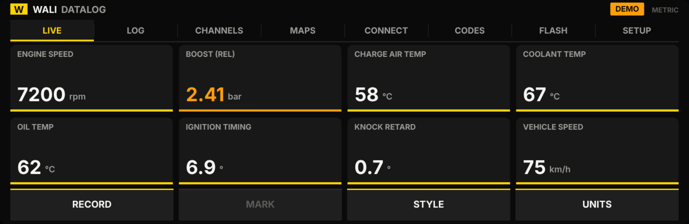

# Wali Datalog — MGU (iDrive 7/8) datalogging for tuned BMWs

An independent app for the BMW **MGU** head unit (iDrive 7 and iDrive 8) that
**datalogs** a tuned car on the car's own screen and, optionally, **switches
tune maps**. It installs through the community iDrive app store
([mgu-store](https://github.com/robertnisipeanu/mgu-store)) like any other MGU
app, and it is built from scratch — see [`NOTICE.md`](NOTICE.md).

> Independent and unaffiliated open-source project. No BMW or tuning-vendor code is used; "BMW", "iDrive" and
> "iDrive" are used only to describe compatibility. The app is **read-only by
> default**; writing maps to the engine is off unless you explicitly enable it.



## Who it's for and what it does

| User | Need it serves |
|------|----------------|
| Driver / owner of a tuned BMW | See boost, timing, mixture, temps live on the iDrive screen; record a pull to a CSV; switch between tune maps without a laptop; keep every log on the car and export to USB. |
| Tuner | Hand a customer a clean, on-screen datalogger; review exported CSV logs in the same format every time; gate map writes behind confirmation and engine-state checks. |

### Features

- **Live dashboard** — pick which channels to show (the Channels screen's
  **Show** toggle, up to a configurable limit) and switch between lightweight
  **Tiles / Bars / Dials** styles (no realtime graph). Amber/red warnings against
  per-channel thresholds. Logged channels (**Log**) are chosen separately.
- **Datalogging** — one-tap **Start/Stop**, a **Marker** button for pulls, pick
  channels, self-describing CSV with units in the header, sessions listed
  on-screen, one-button export to USB. Metric or imperial. Live data can come
  from the fast UDS block read, enhanced PIDs, A2L address reads, bus signals, or a
  read-only **DoIP** client over the car's own diagnostic Ethernet.
- **Full extended tuner class channel set** — ~92 channels (boost actual/target/deviation,
  compressor model, WGDC P/I/D, MAF req, per-cylinder ignition timing and knock,
  lambda actual/target + trims, HPFP/LPFP, port-injection, VANOS, torque, EGT,
  flex-fuel, G-forces, …), read the efficient **packed measurement-block** way.
  The per-tune PID address map is imported as `pidmap.json` (see
  `profiles/template.json`) so every channel goes live on your
  DME without touching code.
- **Import a log preset** — convert a tuner tool's `presets.csv` export to
  a channel preset with `scripts/preset_from_csv.js`, drop it on the unit as
  `preset.json`, and the selection mirrors what you logged on that ECU.
- **Fast UDS block read (B58/S58)** — on a supported tuned car, one UDS exchange
  (`2C 88 01`) returns a 36-byte packed block with ~14 channels already scaled
  (boost/target/deviation, load, coolant, IAT, ethanol, WG distribution, mass
  flow, speed…). No PID map needed; it's the preferred source. Read-only;
  with its block layout from the MIT-licensed `freebeamer/core` (`data/SOURCES.md`).
- **Ready-made B58 / S58 maps** — an attributed, open-sourced enhanced-PID
  dataset (`data/bmw_enhanced_pids.csv`, ~2000 PIDs) and curated
  `profiles/pidmap.b58.json` / `pidmap.s58.json` (21 core channels, scaling +
  units verified by sanity check). Copy one to the unit as `pidmap.json`; it
  stays in demo until you confirm on-car and set `verified:true`. No BMW SGBD/
  EDIABAS binaries are used — see `data/SOURCES.md`.
- **Map control (opt-in)** — switch tune maps via the DME diagnostic job,
  guarded by on-screen confirmation and "stationary + engine idle" preconditions.
  **Off by default.**
- **Open ENET/DoIP diagnostic toolkit** — an open DoIP/ENET transport, a
  **pluggable SecurityAccess (seed/key)** framework whose key algorithm you
  supply for your own ECU (no manufacturer keys bundled), and an **"all-in" test
  ECU** (`test/ecusim.js`) the community can build on off-car.
- **Calibration-section flashing (owner's own vehicle)** — for a car you've
  already flashed that needs only the calibration section rewritten, an open UDS
  flasher built from the standard download services. It bundles no data, keys, or
  addresses — you supply them — refuses to act without explicit per-flash
  acknowledgment, and reports failures honestly. Irreversible and safety-critical;
  see [`docs/FLASHING.md`](docs/FLASHING.md). **Your vehicle, your data, your
  responsibility.**
- **Works without a car** — a clearly-labelled demo mode drives every screen so
  the app can be reviewed and demonstrated off the vehicle.
- **Vehicle connection (ENET/DoIP), gated** — a **Connect** screen (Live → D)
  with a plain-language safety disclosure. No socket is ever opened to the
  vehicle until you **acknowledge** the warning and **enable** the connection —
  and enabling is never remembered: every app launch starts fully disconnected.
  Finds the car automatically (ISO 13400 vehicle discovery, no manual IP entry).
  The live-data path is read-only; writes (map switch, flashing) are separate,
  explicitly-gated actions. See [`docs/VEHICLE-CONNECTION.md`](docs/VEHICLE-CONNECTION.md).

## Quick start

```bash
# Run the test suite (pure logic: CSV, UDS codec, engine, gating, provider)
npm test

# Drive the whole app headless (demo drive + logging + every screen)
npm run sim

# Regenerate the UI screenshots in out/shots/ (bundles + runs the real app code)
npm run shots

# Build the installable packages (iDrive 7 + iDrive 8) and the Store catalog
npm run build:app      # dist/wali_datalog@<v>.tgz/.mgu  +  dist/src/wali_datalog8@<v>.tgz
npm run release        # dist/release/catalog.json + packages + icon
```

Install on a head unit is covered in
[`docs/BUILD-AND-INSTALL.md`](docs/BUILD-AND-INSTALL.md): the CI workflow
publishes a `catalog` GitHub release, and the Store installs the app from it.

## How it's structured

```
apps/wali_datalog/        the MGU app (flat module layout the kit builds)
  app.json                manifest: id (+ id8), signals, screens, settings
  main.js                 controller: wiring, input, view model, loops, kit boot
  icon.png                app tile icon (generated from the "gauge" glyph)
  *.js                    logengine, channels, provider, demo, someip, uds,
                          diag, doip, enetgate, mapcontrol, storage, format,
                          theme, draw, screens, surface (on-device canvas adapter)
kit/                      vendored MGU app kit (MIT): runtime + build.py + id8
tools/                    release.py / release.sh (build the Store catalog)
.github/workflows/        release.yml (publishes the `catalog` GitHub release)
profiles/ presets/        reference PID maps + presets (build-time inputs)
runtime/                  off-car simulator ctx + browser preview backend
scripts/                  bundler, simulator, screenshots, PID/preset generators
test/                     zero-dependency test runner
docs/                     architecture, build/install, signals & DIDs, verification
```

See [`docs/ARCHITECTURE.md`](docs/ARCHITECTURE.md) for the data flow.

## What is verified, and what needs a car

All application logic — the logging state machine and CSV, the UDS/ISO-14229
codec, unit conversion, map-control gating, demo fallback, and every screen's
rendering — is covered by `npm test` (124 assertions) and the headless
`npm run sim`, and the screens are rendered to real pixels by `npm run shots`.

Three things are, by their nature, completed on the actual unit and are clearly
isolated and documented, not faked:

1. **SOME/IP signal names** (`src/signalmap.js`) — the live bus field names are
   per-unit; placeholders are marked `verified:false` and suppressed until
   confirmed, so the app never shows a wrong number.
2. **DME measured-value layout** (`src/dme_profiles.js`) — DID/offset/scaling for
   diagnostic channels is per-DME/tune and must be calibrated.
3. **Device bindings** (canvas present, screen switch, diagnostic transport,
   USB mount) — marked `DEVICE` in `main.js`/`src/ui/surface.js`.

Until those are filled in on a unit, the app runs on demo data and says so.
Full detail and the on-car procedure are in
[`docs/VERIFICATION.md`](docs/VERIFICATION.md) and
[`docs/SIGNALS-AND-DIDS.md`](docs/SIGNALS-AND-DIDS.md).

## Safety

Datalogging only reads. Connecting to the vehicle at all requires acknowledging
a safety disclosure and explicitly enabling it each session (see
[`docs/VEHICLE-CONNECTION.md`](docs/VEHICLE-CONNECTION.md)). The one action that
writes to the engine controller — a map switch — is off by default, requires
turning on "Enable map control" in Settings, asks for on-screen confirmation,
and refuses unless the car is stationary with the engine at idle. You are
responsible for the tune on your car. Provided "as is" under the MIT
[`LICENSE`](LICENSE).
